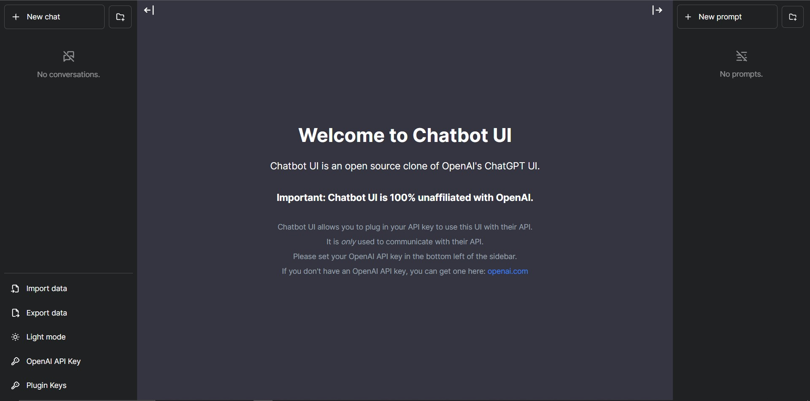

# Claude 仓库：Chatbot UI 聊天界面

基于 [Mckay Wrigley 的 Chatbot UI](https://github.com/mckaywrigley/chatbot-ui) 的 Next.js、React 和 TypeScript 聊天应用快照。提供对话界面、会话管理、提示词管理和多语言界面，通过服务端接口连接配置的模型服务。

本仓库名为 `claude`，当前代码使用 OpenAI/Azure OpenAI 接口；直接使用 Anthropic Claude 需要另外实现对应适配。仓库保留 2023 年版本的依赖和默认模型配置，实际接入时可能需要更新模型列表及接口兼容代码。

## 本地运行

准备 Node.js 和 npm，然后执行：

```bash
git clone https://github.com/1951779219/claude.git
cd claude
npm ci
```

将 `.env.local.example` 复制为 `.env.local`（Windows PowerShell 可用 `Copy-Item .env.local.example .env.local`），填写自己的 `OPENAI_API_KEY`，并检查当前服务可用的模型配置。

```bash
npm run dev
```

浏览器打开 `http://localhost:3000`。如果没有在服务端设置 API Key，原项目允许用户在界面里输入自己的 Key。

## 生产构建与 Docker

```bash
npm run build
npm run start
```

或者在本地构建 Docker 镜像：

```bash
docker build -t chatbot-ui-local .
docker run --env-file .env.local -p 127.0.0.1:3000:3000 chatbot-ui-local
```

该应用的历史版本没有为你的共享服务端 Key 提供完整的公共站点访问控制。对外部署前应自行配置访问控制和费用限制；不要将含真实 Key 的 `.env.local` 提交到 Git。

## 配置与排错

- `OPENAI_API_KEY`：服务端模型服务密钥。
- `OPENAI_API_HOST`：代码所用的 API 主机；如修改，需核对代码拼接路径。
- `OPENAI_API_TYPE`、`OPENAI_API_VERSION`、`AZURE_DEPLOYMENT_ID`：Azure 接入相关配置。
- `DEFAULT_MODEL`：默认模型，同时需与代码内可选模型列表及服务端可用模型匹配。
- `GOOGLE_API_KEY`、`GOOGLE_CSE_ID`：可选搜索功能配置。

依赖安装或构建失败时，先检查 Node.js 与锁文件中旧版依赖的兼容性；模型请求失败时检查 Key、主机地址、模型可用性和服务返回的错误。本次整理没有升级应用依赖或替换旧模型定义。

## 许可与来源

沿用原有 [MIT License](license)，保留 Mckay Wrigley 的版权声明。下面保留上游英文说明，便于查阅原始部署方法与配置表。

---

## Upstream: Chatbot UI

Chatbot UI is an open source chat UI for AI models.

See a [demo](https://twitter.com/mckaywrigley/status/1640380021423603713?s=46&t=AowqkodyK6B4JccSOxSPew).



## Updates

Chatbot UI will be updated over time.

Expect frequent improvements.

**Next up:**

- [ ] Sharing
- [ ] "Bots"

## Deploy

**Vercel**

Host your own live version of Chatbot UI with Vercel.

[](https://vercel.com/new/clone?repository-url=https%3A%2F%2Fgithub.com%2Fmckaywrigley%2Fchatbot-ui)

**Docker**

Build locally:

```shell
docker build -t chatgpt-ui .
docker run -e OPENAI_API_KEY=xxxxxxxx -p 3000:3000 chatgpt-ui
```

Pull from ghcr:

```
docker run -e OPENAI_API_KEY=xxxxxxxx -p 3000:3000 ghcr.io/mckaywrigley/chatbot-ui:main
```

## Running Locally

**1. Clone Repo**

```bash
git clone https://github.com/mckaywrigley/chatbot-ui.git
```

**2. Install Dependencies**

```bash
npm i
```

**3. Provide OpenAI API Key**

Create a .env.local file in the root of the repo with your OpenAI API Key:

```bash
OPENAI_API_KEY=YOUR_KEY
```

> You can set `OPENAI_API_HOST` where access to the official OpenAI host is restricted or unavailable, allowing users to configure an alternative host for their specific needs.

> Additionally, if you have multiple OpenAI Organizations, you can set `OPENAI_ORGANIZATION` to specify one.

**4. Run App**

```bash
npm run dev
```

**5. Use It**

You should be able to start chatting.

## Configuration

When deploying the application, the following environment variables can be set:

| Environment Variable              | Default value                  | Description                                                                                                                               |
| --------------------------------- | ------------------------------ | ----------------------------------------------------------------------------------------------------------------------------------------- |
| OPENAI_API_KEY                    |                                | The default API key used for authentication with OpenAI                                                                                   |
| OPENAI_API_HOST                   | `https://api.openai.com`       | The base url, for Azure use `https://<endpoint>.openai.azure.com`                                                                         |
| OPENAI_API_TYPE                   | `openai`                       | The API type, options are `openai` or `azure`                                                                                             |
| OPENAI_API_VERSION                | `2023-03-15-preview`           | Only applicable for Azure OpenAI                                                                                                          |
| AZURE_DEPLOYMENT_ID               |                                | Needed when Azure OpenAI, Ref [Azure OpenAI API](https://learn.microsoft.com/zh-cn/azure/cognitive-services/openai/reference#completions) |
| OPENAI_ORGANIZATION               |                                | Your OpenAI organization ID                                                                                                               |
| DEFAULT_MODEL                     | `gpt-3.5-turbo`                | The default model to use on new conversations, for Azure use `gpt-35-turbo`                                                               |
| NEXT_PUBLIC_DEFAULT_SYSTEM_PROMPT | [see here](utils/app/const.ts) | The default system prompt to use on new conversations                                                                                     |
| NEXT_PUBLIC_DEFAULT_TEMPERATURE   | 1                              | The default temperature to use on new conversations                                                                                       |
| GOOGLE_API_KEY                    |                                | See [Custom Search JSON API documentation][GCSE]                                                                                          |
| GOOGLE_CSE_ID                     |                                | See [Custom Search JSON API documentation][GCSE]                                                                                          |

If you do not provide an OpenAI API key with `OPENAI_API_KEY`, users will have to provide their own key.

If you don't have an OpenAI API key, you can get one [here](https://platform.openai.com/account/api-keys).

## Contact

If you have any questions, feel free to reach out to Mckay on [Twitter](https://twitter.com/mckaywrigley).

[GCSE]: https://developers.google.com/custom-search/v1/overview
